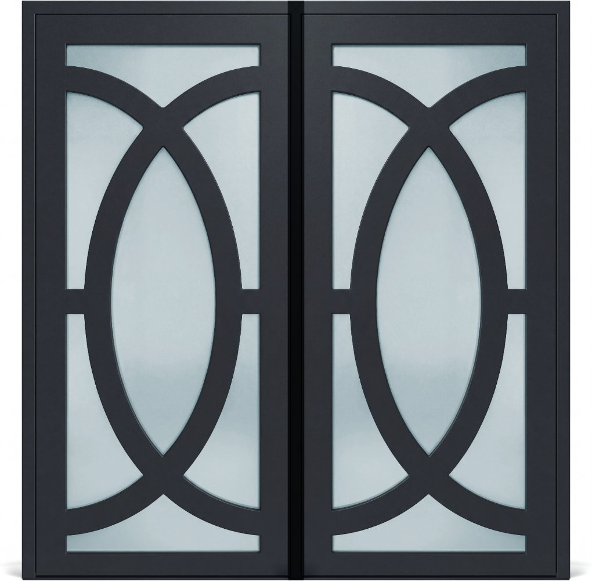
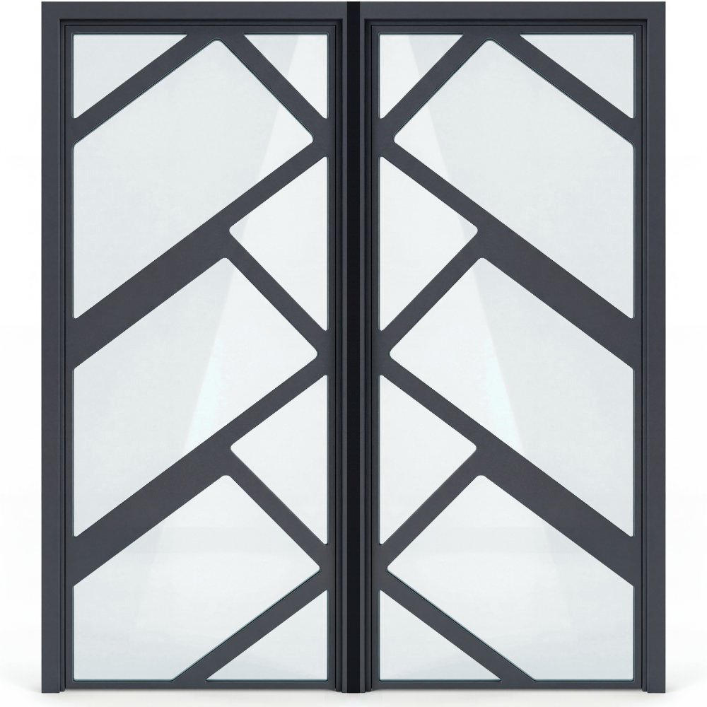
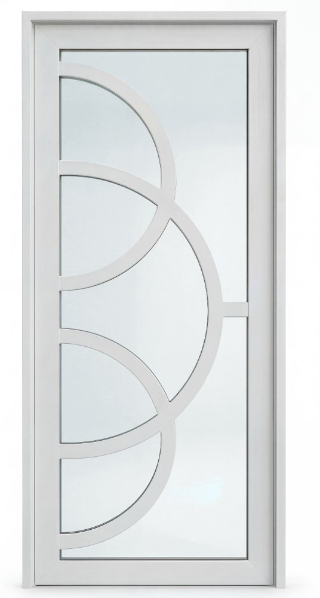
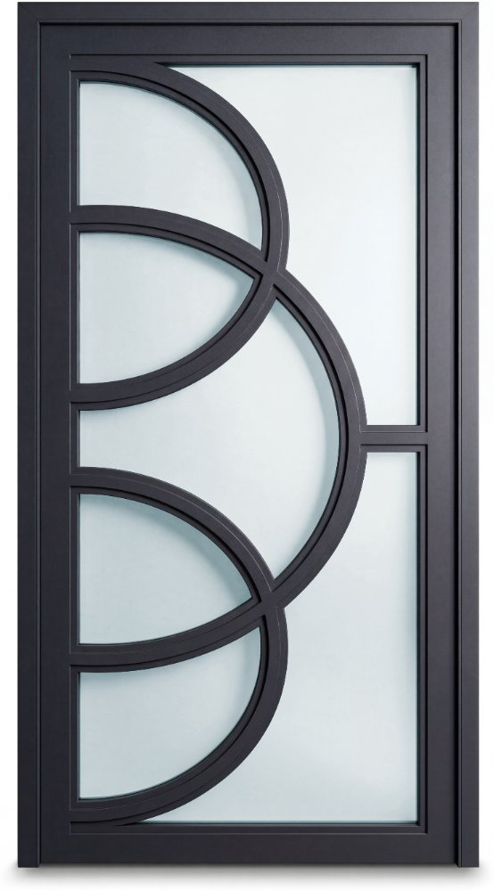
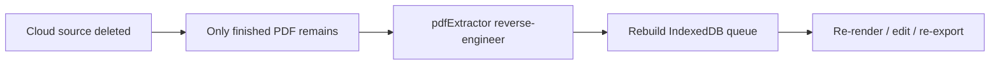

<div align="center">

  # LuxuryCatalog

  **Turn B&W line-art door designs into photorealistic luxury catalog images — with PDF export and disaster-recovery reverse engineering.**

  [](LICENSE)
  [](https://react.dev/)
  [](https://ai.google.dev/gemini-api/docs/image-generation)
  [](https://github.com/RawPowered)

</div>

---

## Why this exists

A luxury door manufacturer needed **photorealistic catalog renders** from basic black-and-white line art — at volume, with consistent teal glass and white/bronze variants. Off-the-shelf tools couldn't batch-process SKU queues, export print-ready PDFs, or recover when cloud source data was **irreversibly deleted**.

LuxuryCatalog uses **Google Gemini Nano Banana** (`gemini-2.5-flash-image` / `gemini-3.1-flash-image-preview`) to transform line art into catalog-ready doors, then exports a full **LUX_Catalog_2026.pdf**. When the only surviving artifact was the finished PDF, the built-in **PDF reverse-engineering pipeline** parsed operator lists and SKU text to rebuild the editable queue.

**Created by:** [Joseph Edwards (@RawPowered)](https://github.com/RawPowered) · MIT licensed

---

## Core capabilities

| Capability | What it does |
|---|---|
| **Nano Banana image gen** | Line art → photorealistic door via Gemini image models; polish, repaint, glass-tune, reshape, structural-fix modes |
| **Batch queue** | IndexedDB-backed queue with white/bronze variants, cross-color structural uniformity |
| **Glass unification** | Canvas HSL post-process for consistent teal frosted glass across catalog |
| **PDF export** | jsPDF catalog: AI covers, index, standard sizes, per-SKU layouts, magazine spreads every 10 SKUs |
| **PDF disaster recovery** | pdfjs operator-list reverse engineering — extract door images + SKUs from finished PDF |
| **WooCommerce export** | ZIP with AI product copy + variation CSV |
| **Chrome extension** | `extension/wp-media-mapper` — WP Media Library → WooCommerce CSV mapper |

---

## Showcase output

Sample renders extracted from a production catalog (client branding redacted to **LUX-**):

<p align="center">
  
  
  
  
</p>

---

## Quick start

**Requirements:** Node.js 18+ · `GEMINI_API_KEY` from [Google AI Studio](https://aistudio.google.com/)

```powershell
git clone https://github.com/RawPowered/LuxuryCatalog.git
cd LuxuryCatalog
copy .env.example .env.local
# Set GEMINI_API_KEY in .env.local
.\Launch-LuxuryCatalog.ps1
```

Or:

```bash
npm install
npm run dev
```

Open `http://localhost:3000` — upload B&W line art, start the queue, export PDF or restore from an existing catalog PDF.

---

## Disaster recovery workflow



1. **Restore from PDF** in the app sidebar
2. pdfjs parses `SKU:` text + color labels and walks `paintImageXObject` operators
3. Spatial matching ties each image to its SKU (150px Y tolerance)
4. Restored items re-enter the queue as completed renders — ready for WooCommerce export or new PDF generation

---

## Project layout

```
LuxuryCatalog/
├── src/
│   ├── App.tsx              # Orchestrator UI
│   ├── lib/
│   │   ├── gemini.ts        # Nano Banana model config
│   │   ├── db.ts            # IndexedDB queue
│   │   ├── pdfExtractor.ts  # PDF reverse engineering
│   │   ├── pdfExport.ts     # Export constants
│   │   ├── pdfImageUtils.ts # Double-door compositing, crop, resize
│   │   ├── glassModifier.ts # Teal glass unification
│   │   └── catalogBranding.ts
│   └── components/
├── extension/wp-media-mapper/  # WooCommerce Chrome extension
├── assets/showcase/              # Redacted sample renders
├── scripts/extract_showcase.py   # Regenerate showcase PNGs from PDF
└── EnVars/
```

---

## Gemini models

| Tier | Model | Use |
|---|---|---|
| Free | `gemini-2.5-flash-image` | Door renders, covers, spreads |
| Pro | `gemini-3.1-flash-image-preview` | 4K door renders |
| Text | `gemini-3-flash-preview` | WooCommerce copy, AI SKU sort |

---

## Chrome extension

Load unpacked: `extension/wp-media-mapper/` — scrape WordPress Media Library, map filenames to SKUs, export WooCommerce variable product CSV.

---

## License

MIT — see [LICENSE](LICENSE).
