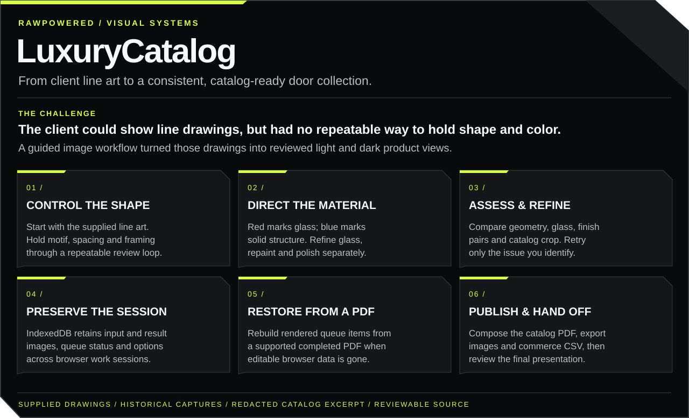
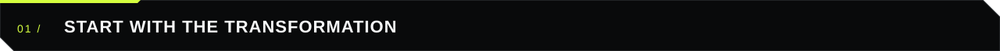
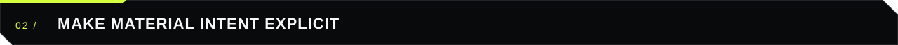
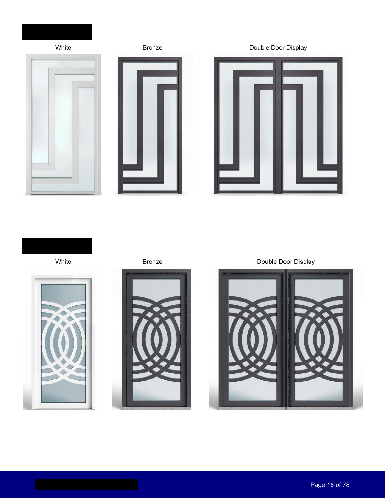
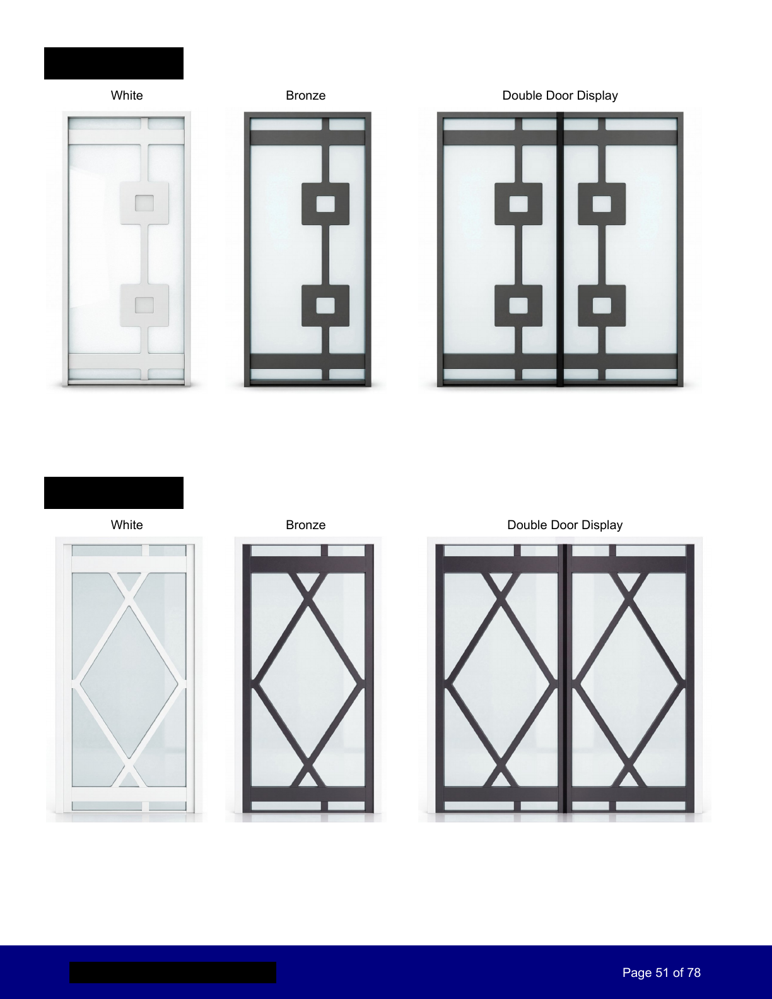
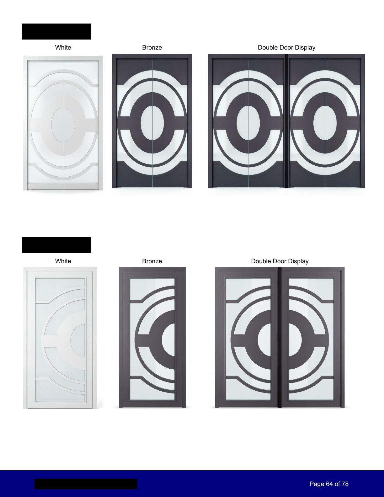

# LuxuryCatalog

**From supplied door drawings to realistic, catalog-ready product imagery.**

The client came to me with a specific problem: line drawings were all they could show, and their team had not found a repeatable way to keep the doors' shape and color consistent. I developed material guides, targeted correction controls and a review workflow that carried the designs into a finished catalog. This is my account of the brief; the preserved inputs, interface captures, output PDF and source let you examine the work.

**Four systems behind the result:** visual assessment and refinement; persistent browser work sessions in IndexedDB; restoration of rendered items from a supported completed PDF; and catalog and commerce exports. The feature board maps the full workflow above. Browser persistence refers to IndexedDB rather than the browser's temporary `sessionStorage`.

   

<h2 id="start-with-the-transformation"></h2>

The drawing was supplied to me. The finished images come from the supplied catalog PDF. This comparison follows the same diamond design family; it presents preserved inputs and outputs rather than a newly executed generation run.

<h2 id="make-material-intent-explicit"></h2>

**Red = frosted glass. Blue = solid frame and panels.** The structural-guide prompts encode that distinction. The workflow then provides separate controls for structural correction, repainting, glass tuning and rendering polish.

<table><tr><td width="55%" valign="top">
<strong>March 16, 2026: interpret the geometry.</strong> A supplied capture shows the material guide alongside an intermediate render.
</td><td width="45%" valign="top">
<strong>April 4, 2026: refine the catalog presentation.</strong> Light and dark variants with visible queue controls.
</td></tr></table>

These are dated examples from the same motif family. The [design case](docs/DESIGN-PROCESS.md) explains the review criteria and evidence boundaries.

<h2 id="publish-the-catalog"></h2>

The supplied example contains **78 PDF pages**. This public showcase includes **three brand-redacted page excerpts**, retaining the original product layout, finish labels and page numbers.

<table><tr><td width="33%"></td><td width="33%"></td><td width="33%"></td></tr></table>

The source PDF remains private. The excerpt is image-only, with identifying text removed from the pixels before assembly. The full gallery contains the selected evidence collection, including additional input and render captures; it does not reproduce the entire client catalog.

<h2 id="explore-the-build"></h2>

| Area | Delivered implementation | Inspect |
|:--|:--|:--|
| Visual generation and correction | Image-model requests, structural guides, repaint, polish, glass-tune and reshape paths | [Design process](docs/DESIGN-PROCESS.md) |
| Catalog consistency | Light/dark variants, reference-image context, glass hue processing and per-item overrides | [Image pipeline](docs/FEATURES-AND-SOURCE.md#image-pipeline) |
| Persistent work queue | IndexedDB stores input/result blobs, item state and editing flags; UI exposes review and retry controls | [Queue and review](docs/FEATURES-AND-SOURCE.md#queue-and-review) |
| PDF publishing | Product layouts, finish labels, paired-door compositing, covers, contents and lifestyle-spread tools | [Publishing](docs/FEATURES-AND-SOURCE.md#publishing) |
| Recovery from PDF | Extract supported embedded images and nearby SKU/color text to rebuild rendered queue items | [Recovery](docs/FEATURES-AND-SOURCE.md#recovery-from-a-finished-pdf) |
| Commerce handoff | Image ZIP, WooCommerce variation CSV, assisted copy and a WordPress media-mapping extension | [Commerce](docs/FEATURES-AND-SOURCE.md#commerce-handoff) |

<h2 id="review-the-decisions-with-me"></h2>

For design and AI-assisted product roles, ask how I converted ambiguous line work into material instructions and judged the resulting geometry, glass and finish. For engineering roles, follow the queue state, image processing, export layout and recovery path.

Historical screenshots span February through April 2026. They establish visible work and output; the code supplies implementation detail. [Evidence and current checks](docs/EVIDENCE.md) distinguish captured results from features represented in source.

 

Software source: [MIT license](LICENSE). Supplied artwork and evidence media: [media rights](assets/evidence/README.md). [Joseph Edwards on LinkedIn](https://www.linkedin.com/in/josephedwardscto/).
