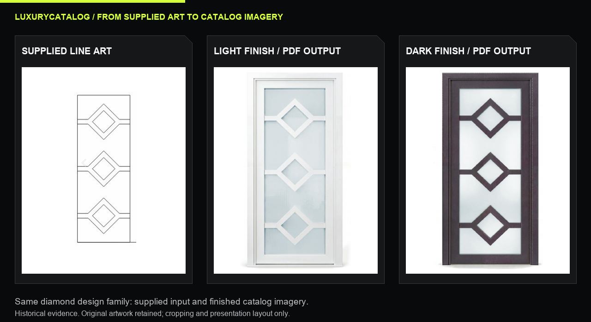
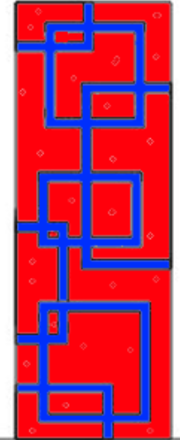
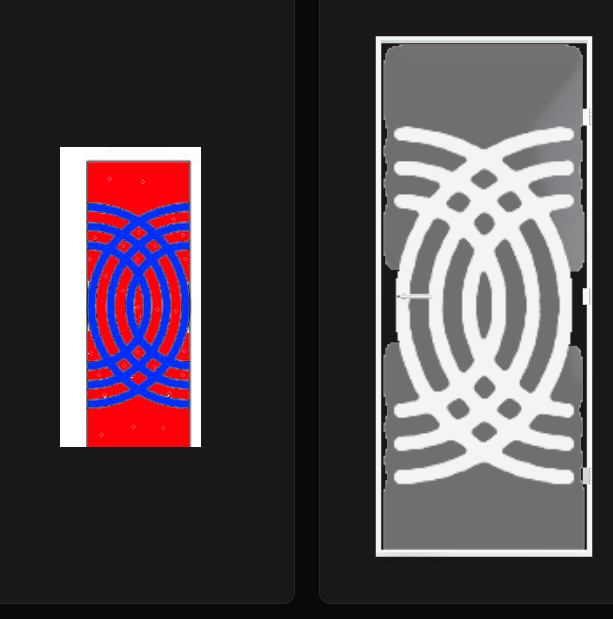
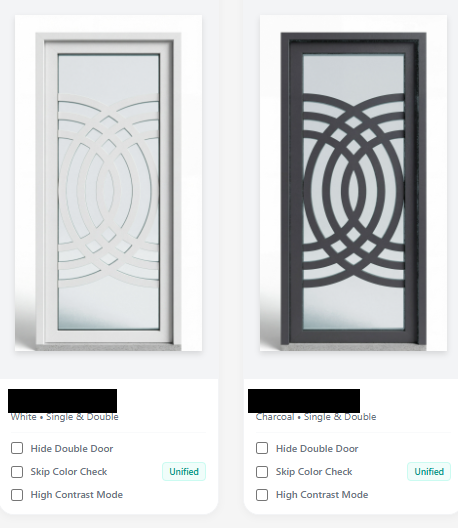

# From line art to a consistent catalog

[Overview](../README.md) · [Full gallery](GALLERY.md) · [Implementation map](FEATURES-AND-SOURCE.md)

## The brief

The client presented this as a problem their team had not been able to solve consistently. They could show prospective buyers only line art. Attempts to turn the drawings into realistic doors did not reliably preserve both the shape and the color. My task was to build a repeatable path to catalog-ready imagery. A useful result had to retain the recognizable motif, distinguish glass from solid structure, work in light and dark finishes, and sit consistently beside other products in a catalog. This description of the original brief comes from my project account; the preserved drawings and outputs show the design problem and the resulting work.

The drawing gives shape information, while the final image needs material, depth, light and presentation decisions. My workflow made those decisions explicit and gave the operator separate correction controls.

## 1. Read the shape before directing the render

The supplied line-art captures show diamond and rectangular motifs. I treated those references as the starting design constraint. The source-to-output board compares the diamond design family with door-only crops from page 8 of the finished PDF. The original supplied drawing remains credited as input.

A reviewer can compare spacing, repeated motifs and frame proportions. These images support a design discussion; they are not manufacturing drawings, dimension verification or photographs of manufactured products.

## 2. Make the glass and structure unambiguous

The March captures use a two-color guide. In the structural-guide branch of [App.tsx](../src/App.tsx), **red denotes frosted glass panes and blue denotes solid frame/panel material**. That instruction tells the model how to interpret areas that could otherwise become outlines, solid blocks or glass inconsistently.

The guide is supplied to the image request alongside the selected finish and rendering instructions. The code also describes a white studio background, controlled shadows and material treatment. Prompt wording defines the requested result; the operator still needs to inspect the generated image.

## 3. Review structure, material and presentation separately

The interface offers separate operations for repainting, polishing, glass tuning, structural fixes and reshaping. That separation lets a reviewer name the issue before choosing a correction.

| Review question | Useful criterion | Relevant control |
|:--|:--|:--|
| Did the intended motif survive? | Compare connected shapes, repeated geometry and proportions with the guide | Structural fix or reshape, followed by visual review |
| Is glass still readable as glass? | Look for translucency, controlled tint and appropriate highlights | Glass tune and optional color unification |
| Do finish variants describe the same design? | Compare geometry and framing across the light/dark pair | Variant reference context and repaint |
| Will the image sit consistently in the catalog? | Review crop, background, grounding shadow and contrast | Polish, crop and per-item controls |

The March 16 and April 4 captures preserve different stages in the loop motif family. Their dates and visual relationship are visible; a direct model-call lineage between those files has not been independently reconstructed. The screenshot label “Studio 3D Render” is historical UI text. The documented current pipeline uses image generation and canvas processing, rather than proving a geometric 3D model.

## 4. Control catalog-wide glass appearance

[glassModifier.ts](../src/lib/glassModifier.ts) analyzes pixel hue, saturation and lightness, targeting a bounded green-to-blue range. It moves selected pixels toward a shared hue/saturation while retaining original lightness and blending the adjustment. This preserves some highlight/shadow structure while reducing color variation.

It is a color heuristic. It does not semantically identify every glass pane, and other colored regions can fall inside the same thresholds. The application exposes per-item skip controls and a “Unified” indicator so review remains visible. Source settings currently default to hue 195 and saturation 0.15.

## 5. Carry the work into publishing

The output workflow groups images by SKU, associates finish variants and provides single/double-door presentation options. The double-door utility composites paired images with overlap and flip controls. The PDF workflow adds product layouts and optional covers, contents and lifestyle spreads.

The historical queue labels the dark finish as Charcoal; the supplied PDF uses Bronze, and the source documents that internal mapping. The showcase uses “light” and “dark” for comparisons and preserves original labels in the evidence.

The three published PDF pages demonstrate actual layout output. Their dimensions, colors and product presentation are retained; client identifiers are covered. [View the PDF excerpt](../output/pdf/LuxuryCatalog-Selected-Pages-Redacted.pdf).

## What this demonstrates for a design reviewer

This case combines visual interpretation, material communication, critique, interface design and output consistency. In an interview, I can explain a specific failure mode, the control used to address it and what I would inspect before accepting the result. The evidence supports those decisions without inventing a measured accuracy rate, production volume, turnaround saving or conversion result.
