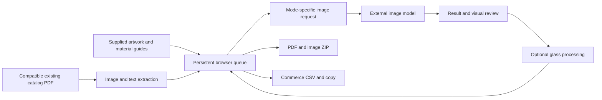

# Features and implementation

[Overview](../README.md) · [Design process](DESIGN-PROCESS.md) · [Evidence](EVIDENCE.md) · [Local setup](LOCAL-SETUP.md)

## Image pipeline

- **Generation and retouching:** [App.tsx](../src/App.tsx) assembles image inputs, mode-specific prompts and model requests. Its branches include structural correction, reshape, repaint, polish and glass tuning.
- **Model configuration:** [gemini.ts](../src/lib/gemini.ts) centralizes model IDs, image configuration and inline-image extraction. These are configured identifiers in the source; availability and provider billing need to be checked when running it. Internal tier names are not a promise of free usage.
- **Variant reference:** the orchestrator can supply an existing counterpart image as context when generating a finish variant. This is an instruction/reference mechanism, with visual review still required.
- **Glass consistency:** [glassModifier.ts](../src/lib/glassModifier.ts) adjusts selected hue/saturation ranges while retaining lightness and blending pixel changes.
- **Finish reconciliation:** [ColorSyncPlugin.tsx](../src/components/ColorSyncPlugin.tsx) uses brightness analysis to help reconcile finish labels. Its heuristic can require manual correction.
- **Image utilities:** [pdfImageUtils.ts](../src/lib/pdfImageUtils.ts) includes white-background cropping, resizing and paired-door compositing with configurable overlap and flips.

## Queue and review

[db.ts](../src/lib/db.ts) uses IndexedDB to store the original blob, result blob, file/SKU identity, finish, status, errors and editing flags. Queue states include pending, processing, completed and failed. A second store retains spread records.

[QueueItemCard.tsx](../src/components/QueueItemCard.tsx) exposes original/result images, status, download, correction controls, double-door visibility and color-check options. The orchestrator handles multi-file/folder intake, pause/resume behavior, retry/re-render actions, SKU changes, sorting and resource linking.

Browser persistence helps retain work between sessions. It remains subject to browser storage clearing, origin changes and storage limits. Exported files and independent backups are separate concerns.

## Publishing

The `generatePDF` flow in [App.tsx](../src/App.tsx) uses jsPDF. [pdfExport.ts](../src/lib/pdfExport.ts) records portrait Letter layout and the spread interval; [catalogBranding.ts](../src/lib/catalogBranding.ts) centralizes publish-safe placeholder branding.

Source-backed options include:

- Front/back cover generation or upload, with separate overlay controls.
- Contents and standard-size pages, SKU grouping and product layouts.
- Finish labels and optional double-door presentation.
- Manual ordering and assisted SKU sorting.
- Lifestyle spreads generated or uploaded for selected designs.
- Image download and ZIP packaging.

The supplied 78-page PDF demonstrates a completed export artifact. Only source pages 18, 51 and 64 are included as full-page public excerpts. Two additional door-only crops from source page 8 support the line-art comparison. The evidence does not establish print-vendor acceptance, manufacturing specifications or current operation of every export option.

## Recovery from a finished PDF

[pdfExtractor.ts](../src/lib/pdfExtractor.ts) combines PDF.js text positions and embedded-image operators. It associates extracted images with nearby SKU/finish labels and returns rendered images for queue restoration through [PdfExtractorModal.tsx](../src/components/PdfExtractorModal.tsx) and the app's restore handler.

The implementation contains bounded image sizes, image-fetch and page timeouts, progress messages and per-page failure handling. Matching is layout-dependent. It does not recover the original line art, full edit history or lost model prompts from a flattened rendered image. The rasterized public excerpt deliberately removes searchable client labels and is intended for viewing, rather than testing this recovery contract.

## Commerce handoff

The WooCommerce export path in [App.tsx](../src/App.tsx) assembles product/variation rows and image files, with model-assisted product copy and fallback text. Publishing still requires review of generated descriptions, media URLs, variation mapping and destination settings.

The separate [WordPress media mapper](../extension/wp-media-mapper/) reads media-library context and helps map images to catalog rows. Inspect its [manifest](../extension/wp-media-mapper/manifest.json), [content script](../extension/wp-media-mapper/content.js) and [CSV interface](../extension/wp-media-mapper/popup.js). It requests broad host permissions; review those against the sites where it will be used. This portfolio update did not connect to or modify a WordPress site.

## Architecture at a glance

This describes the source design. Historical captures and the supplied PDF provide the separate output evidence.
