# Evidence gallery

[Overview](../README.md) · [Design process](DESIGN-PROCESS.md) · [Evidence and provenance](EVIDENCE.md) · [Selected PDF](../output/pdf/LuxuryCatalog-Selected-Pages-Redacted.pdf)

The complete curated collection: 28 newly prepared evidence images and 12 retained repository renders. The original branded catalog is private. Images below preserve actual source pixels; identifying text has been cropped or covered. Open any image for its available resolution.

[Supplied input](#supplied-input) · [Material guides](#material-guides) · [Studio iterations](#studio-iterations) · [Finished variants](#finished-variants) · [PDF output](#pdf-output) · [Earlier layouts](#early-layouts) · [Existing renders](#existing-renders)

<h2 id="supplied-input">Supplied line art</h2>

<table>
<tr>
<td width="33%" valign="top"><a href="../assets/evidence/line-art-pair.png">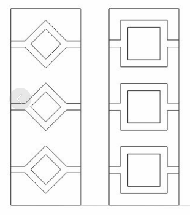</a>
<strong>Supplied line art: diamond and rectangular designs</strong> 2026-02-25
</td>
<td width="33%" valign="top"><a href="../assets/evidence/line-art-diamond-01.png">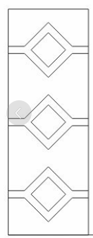</a>
<strong>Supplied diamond line art, capture 1</strong> 2026-02-25
</td>
<td width="33%" valign="top"><a href="../assets/evidence/line-art-diamond-02.png">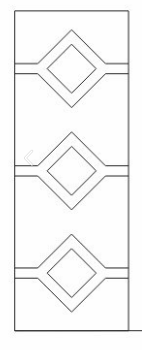</a>
<strong>Supplied diamond line art, capture 2</strong> 2026-02-25
</td>
</tr>
<tr>
<td width="33%" valign="top"><a href="../assets/evidence/line-art-diamond-03.png">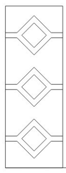</a>
<strong>Supplied diamond line art, capture 3</strong> 2026-02-25
</td>
<td width="33%" valign="top"><a href="../assets/evidence/line-art-diamond-04.png">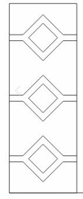</a>
<strong>Supplied diamond line art, capture 4</strong> 2026-02-25
</td>
<td width="33%" valign="top"><a href="../assets/evidence/line-art-diamond-05.png">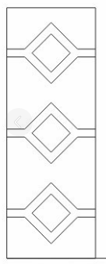</a>
<strong>Supplied diamond line art, capture 5</strong> 2026-02-25
</td>
</tr>
<tr>
<td width="33%" valign="top"><a href="../assets/evidence/line-art-diamond-06.png">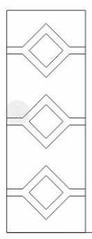</a>
<strong>Supplied diamond line art, capture 6</strong> 2026-02-25
</td>
<td width="33%" valign="top"><a href="../assets/evidence/line-art-rectangles.png">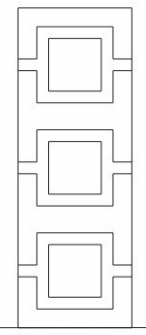</a>
<strong>Supplied rectangular line art</strong> 2026-02-25
</td>
</tr>
</table>

<h2 id="material-guides">Red / blue material guides</h2>

**Red: glass. Blue: solid frame/panels.** This mapping is explicit in the structural-guide prompts.

<table>
<tr>
<td width="33%" valign="top"><a href="../assets/evidence/material-guide-sweep.png">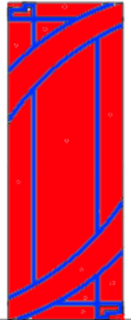</a>
<strong>Red glass / blue structure: swept motif</strong> 2026-03-11
</td>
<td width="33%" valign="top"><a href="../assets/evidence/material-guide-cross.png">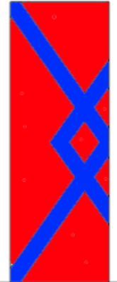</a>
<strong>Red glass / blue structure: crossed motif</strong> 2026-03-11
</td>
<td width="33%" valign="top">
<strong>Red glass / blue structure: linked squares</strong> 2026-03-11
</td>
</tr>
<tr>
<td width="33%" valign="top"><a href="../assets/evidence/material-guide-grid.png">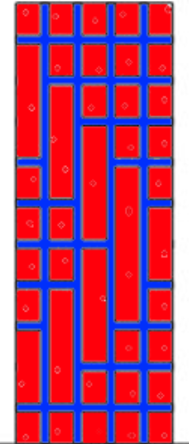</a>
<strong>Red glass / blue structure: grid motif</strong> 2026-03-11
</td>
<td width="33%" valign="top"><a href="../assets/evidence/material-guide-offset.png">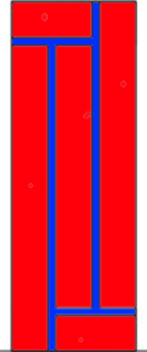</a>
<strong>Red glass / blue structure: offset motif</strong> 2026-03-11
</td>
</tr>
</table>

<h2 id="studio-iterations">Intermediate studio captures</h2>

<table>
<tr>
<td width="33%" valign="top">
<strong>Historical material guide beside an intermediate loop render</strong> 2026-03-16
</td>
<td width="33%" valign="top"><a href="../assets/evidence/studio-oval-comparison.png">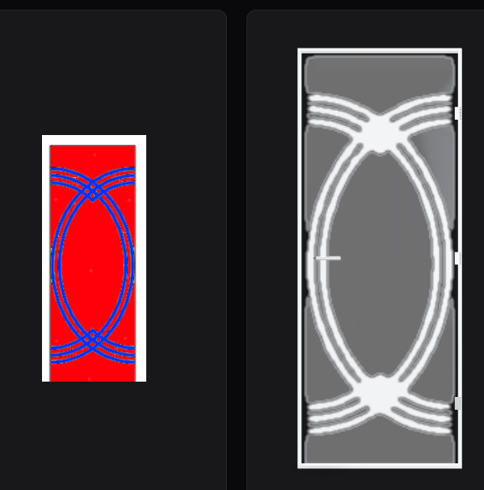</a>
<strong>Historical material guide beside an intermediate oval render</strong> 2026-03-16
</td>
<td width="33%" valign="top"><a href="../assets/evidence/studio-square-comparison.png">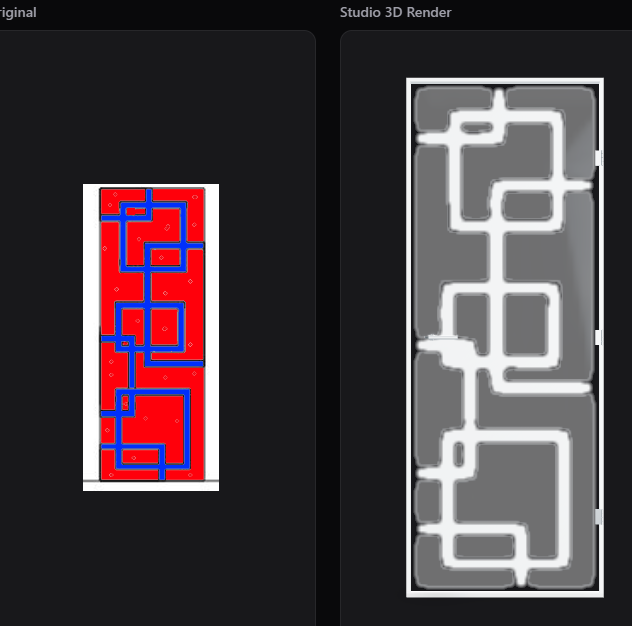</a>
<strong>Historical material guide beside an intermediate geometric render</strong> 2026-03-16
</td>
</tr>
</table>

<h2 id="finished-variants">Finished variants and queue</h2>

<table>
<tr>
<td width="33%" valign="top"><a href="../assets/evidence/finished-queue.png">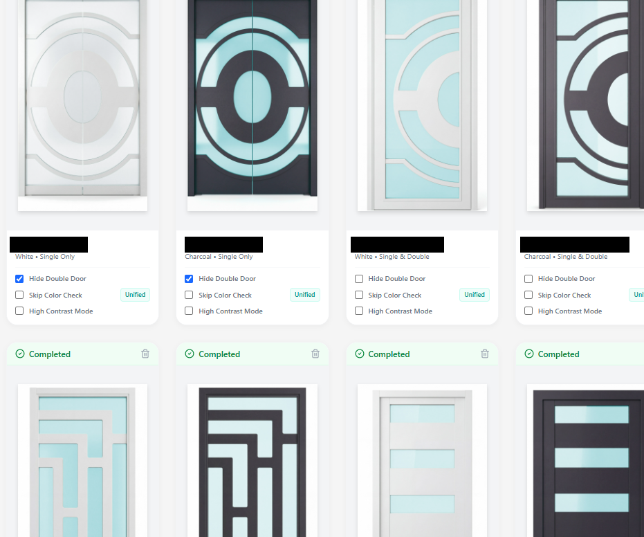</a>
<strong>Completed queue with light and dark finish variants</strong> 2026-04-04
</td>
<td width="33%" valign="top"><a href="../assets/evidence/finished-loop-detail.png">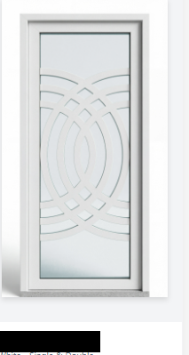</a>
<strong>Refined light-finish loop design</strong> 2026-04-04
</td>
<td width="33%" valign="top">
<strong>Refined loop design in light and dark finishes</strong> 2026-04-04
</td>
</tr>
<tr>
<td width="33%" valign="top"><a href="../assets/evidence/finished-offset-variants.png">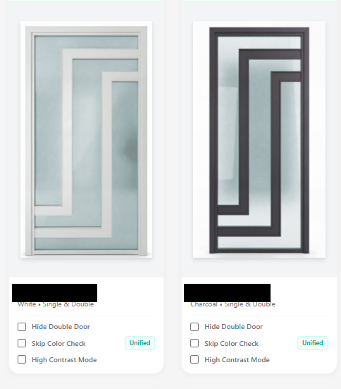</a>
<strong>Refined offset design in light and dark finishes</strong> 2026-04-05
</td>
<td width="33%" valign="top"><a href="../assets/evidence/additional-render-montage.png">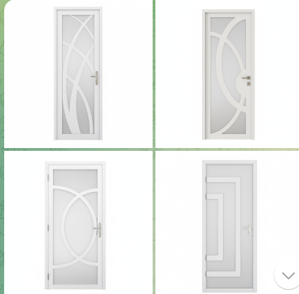</a>
<strong>Additional supplied render montage</strong> Undated
</td>
</tr>
</table>

<h2 id="pdf-output">Selected catalog output</h2>

<table>
<tr>
<td width="33%" valign="top">
<strong>Actual catalog output, source page 18 of 78</strong> 2026 catalog; export date unverified
</td>
<td width="33%" valign="top">
<strong>Actual catalog output, source page 51 of 78</strong> 2026 catalog; export date unverified
</td>
<td width="33%" valign="top">
<strong>Actual catalog output, source page 64 of 78</strong> 2026 catalog; export date unverified
</td>
</tr>
<tr>
<td width="33%" valign="top"><a href="../assets/evidence/diamond-output-light.png">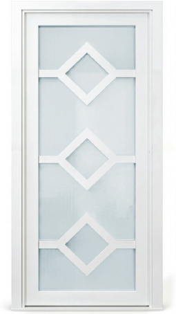</a>
<strong>Diamond design, light finish from supplied catalog</strong> 2026 catalog; export date unverified
</td>
<td width="33%" valign="top"><a href="../assets/evidence/diamond-output-dark.png">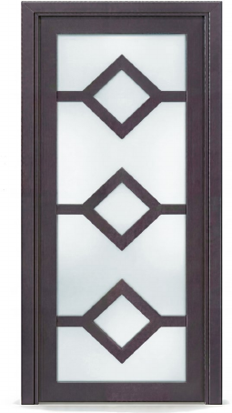</a>
<strong>Diamond design, dark finish from supplied catalog</strong> 2026 catalog; export date unverified
</td>
</tr>
</table>

<h2 id="early-layouts">Early catalog layout context</h2>

Earlier layout context; individual image authorship is not established by these captures alone.

<table>
<tr>
<td width="33%" valign="top"><a href="../assets/evidence/early-catalog-01.png">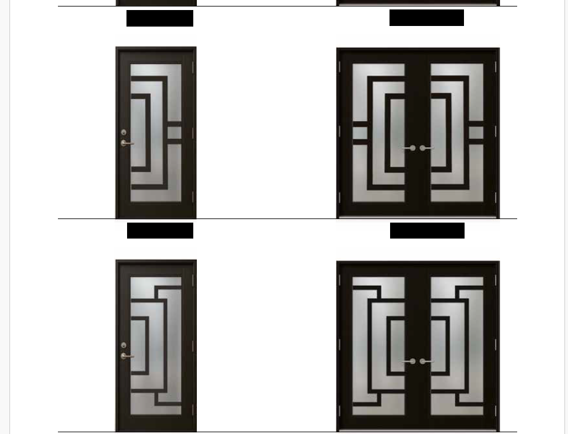</a>
<strong>Early catalog layout capture 1</strong> 2026-02-23
</td>
<td width="33%" valign="top"><a href="../assets/evidence/early-catalog-02.png">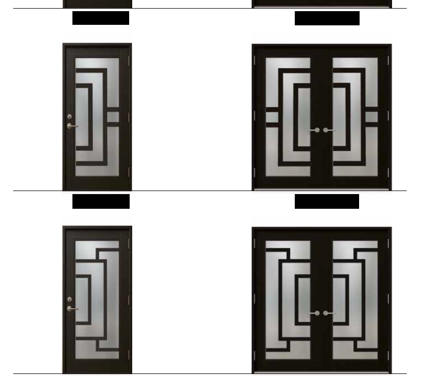</a>
<strong>Early catalog layout capture 2</strong> 2026-02-23
</td>
</tr>
</table>

<h2 id="existing-renders">Existing repository render collection</h2>

These twelve previously published samples remain available as additional visual references.

<table>
<tr>
<td width="25%">
Render sample 1
</td>
<td width="25%">
Render sample 2
</td>
<td width="25%">
Render sample 3
</td>
<td width="25%">
Render sample 4
</td>
</tr>
<tr>
<td width="25%"><a href="../assets/showcase/LUX-sample-5.png">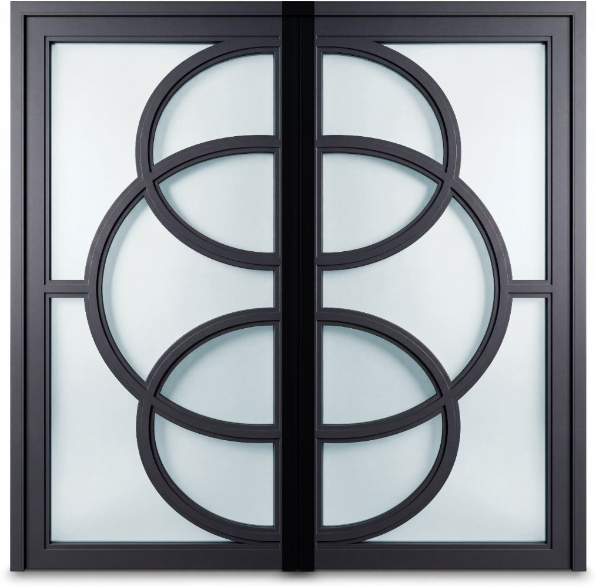</a>
Render sample 5
</td>
<td width="25%"><a href="../assets/showcase/LUX-sample-6.png">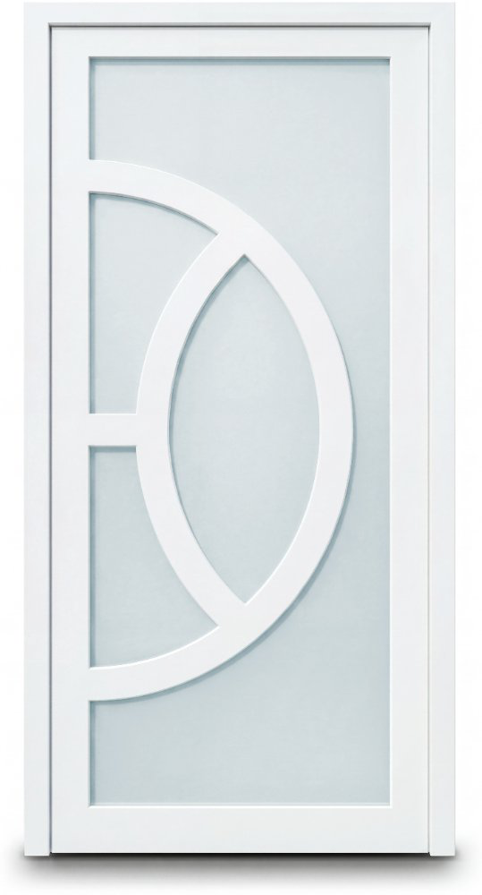</a>
Render sample 6
</td>
<td width="25%"><a href="../assets/showcase/LUX-sample-7.png">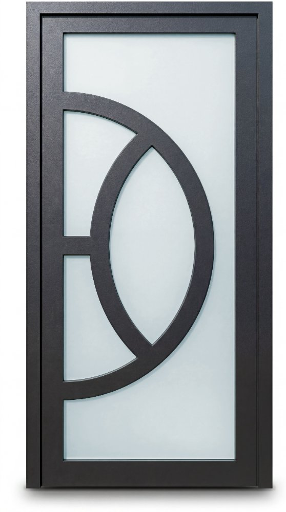</a>
Render sample 7
</td>
<td width="25%"><a href="../assets/showcase/LUX-sample-8.png">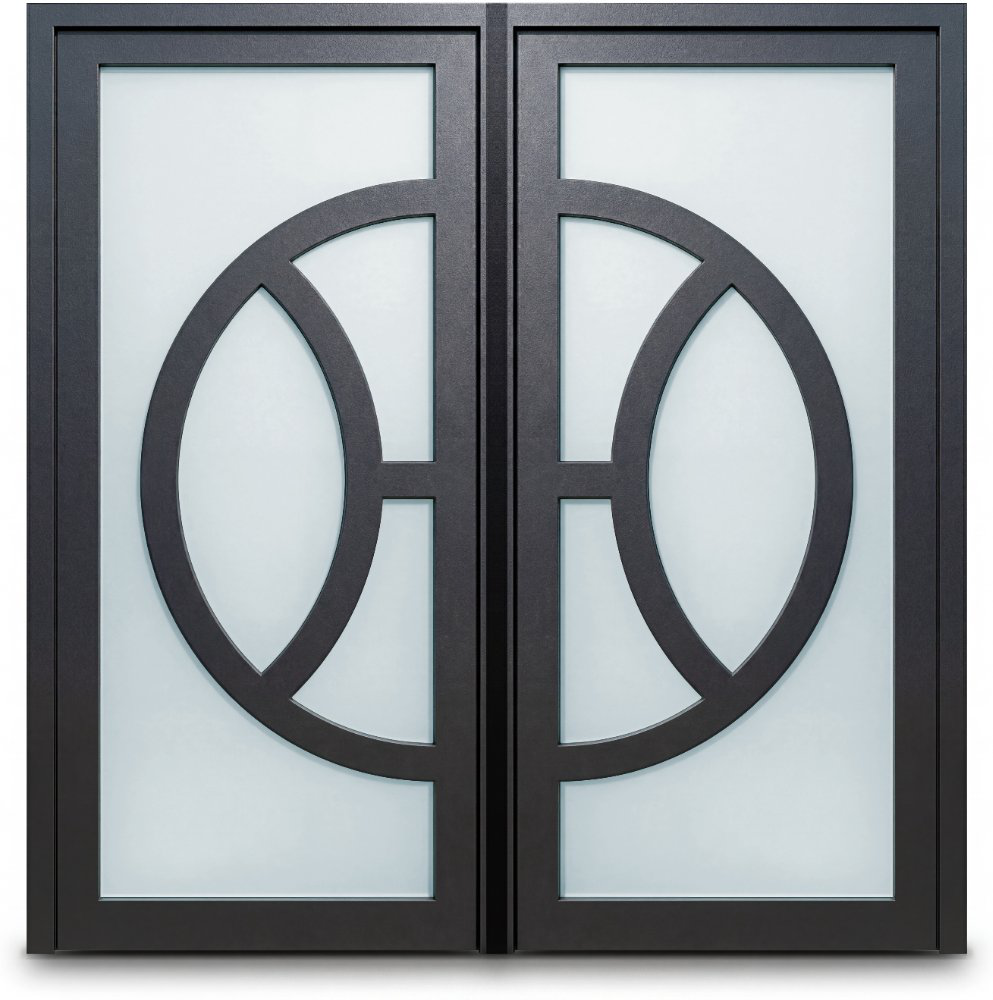</a>
Render sample 8
</td>
</tr>
<tr>
<td width="25%"><a href="../assets/showcase/LUX-sample-9.png">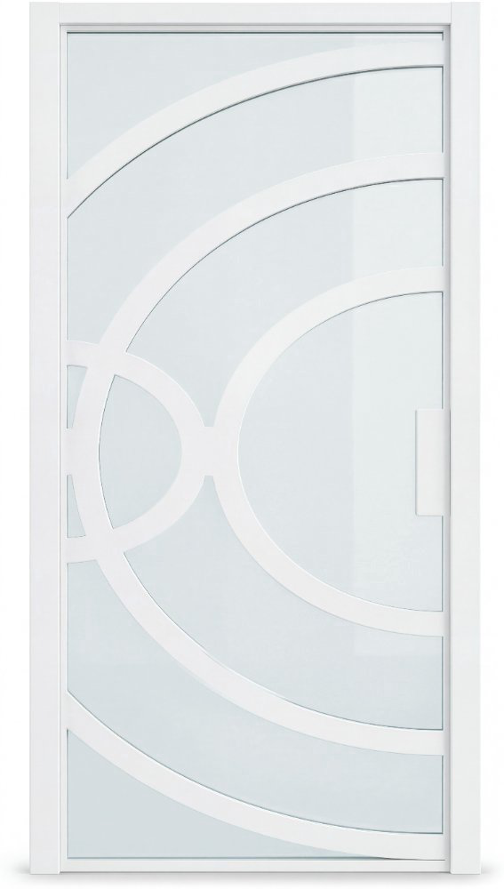</a>
Render sample 9
</td>
<td width="25%"><a href="../assets/showcase/LUX-sample-10.png">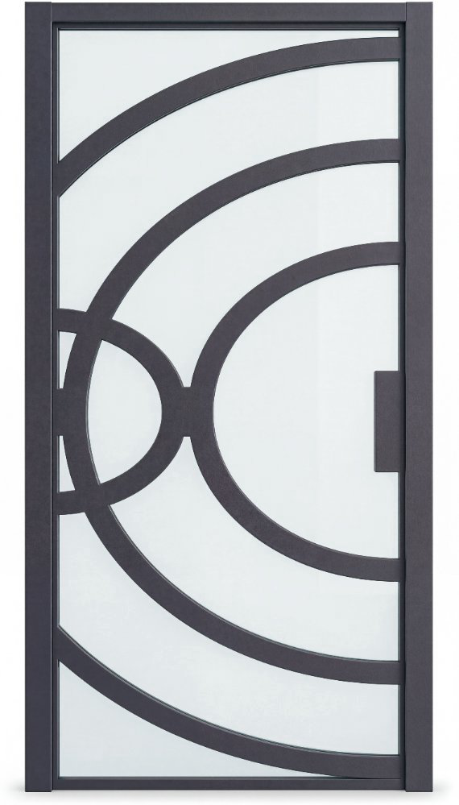</a>
Render sample 10
</td>
<td width="25%"><a href="../assets/showcase/LUX-sample-11.png">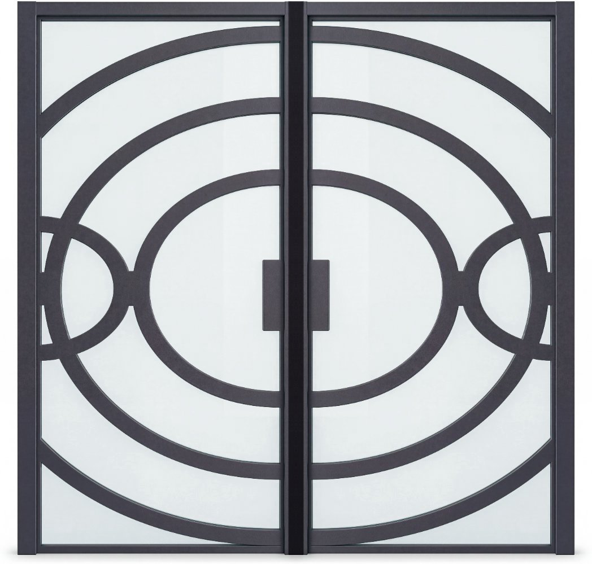</a>
Render sample 11
</td>
<td width="25%"><a href="../assets/showcase/LUX-sample-12.png">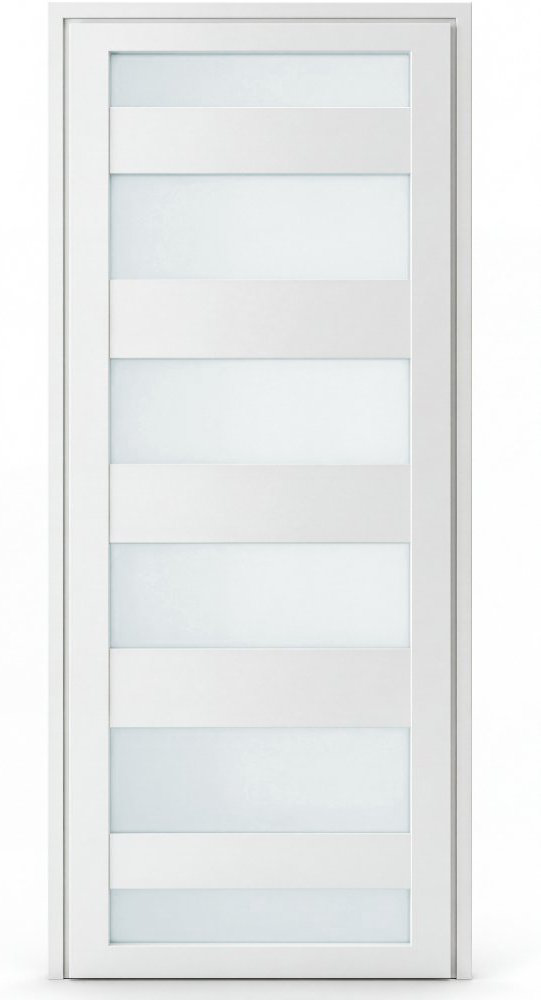</a>
Render sample 12
</td>
</tr>
</table>

[Return to the main showcase](../README.md)
